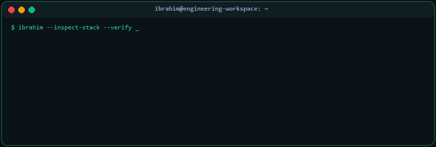

  

   

  <!-- Animated Typing Subtitle -->
  

  

    
    
    
    
  

# Hi, I'm İbrahim Türkel 

**Computer Engineering Student · AI Systems · Backend Development**

I build practical software with a focus on **AI agents**, **local LLMs**, and **reliable backend systems**. I'm especially interested in turning AI ideas into maintainable, testable applications.

  

## 🚀 What I'm Working On

<table>
  <tr>
    <td width="50%" valign="top">
      <h3>🤖 AI COMPANY OS  <code>In Development · Multi-Agent Architecture</code></h3>
      

        Designing an AI-powered company operating system built around specialized agents, shared project context, task orchestration, and human approval for critical actions. The goal is to create a modular architecture that can coordinate research, development, testing, and reporting while keeping actions auditable.
      

    </td>
    <td width="50%" valign="top">
      <h3>📜 <a href="https://github.com/turkelibrahim/INTELLIGENT-OTTOMAN-TURKISH-ASSISTANT">Intelligent Ottoman Turkish Assistant</a>  <code>In Development · Historical OCR & NLP</code></h3>
      

        Building an AI-assisted workflow for historical Ottoman Turkish documents, with a focus on document image processing, OCR, transcription, modern Turkish translation, and metadata extraction. The priority is improving the existing system without compromising working functionality.
      

    </td>
  </tr>
  <tr>
    <td width="50%" valign="top">
      <h3>🧠 Local LLM &amp; Resource-Efficient AI  <code>Active Research · Local Inference</code></h3>
      

        Exploring practical ways to run and evaluate open-source language models locally, with attention to memory and VRAM constraints, reproducible setup, and useful integrations.
      

    </td>
    <td width="50%" valign="top">
      <h3>🌐 Full-Stack &amp; AI Web Platforms  <code>Prototypes &amp; Applied Systems</code></h3>
      

        • <a href="https://github.com/turkelibrahim/Smart_personnel_newspaper"><b>Smart Personnel Newspaper</b></a> — NLP-driven personalized news feed &amp; daily briefing 
        • <a href="https://github.com/turkelibrahim/english_platform"><b>AI-Powered English Platform</b></a> — Adaptive student path &amp; Gemini admin test generator 
        • <a href="https://github.com/turkelibrahim/react_web_ev-otomasyon-sistemi"><b>AuraHome</b></a> &amp; <a href="https://github.com/turkelibrahim/quiz_platform"><b>Adaptive Quiz Engine</b></a>
      

    </td>
  </tr>
</table>

> 💡 *These projects are works in progress. Their descriptions reflect the intended scope, not a claim that every feature is already complete.*

## 🛠️ Technical Interests

  
  
  
  
  
  
  
  
  
  
  
  

- **AI / NLP:** LLM applications, agent workflows, prompt design, local model deployment
- **Backend & Programming:** Python, JavaScript, TypeScript, Node.js, PHP
- **Data & Web:** MySQL, REST-oriented application design, responsive UI development
- **Tools & Environment:** Git, GitHub, Linux, Ubuntu on WSL, Hugging Face, Ollama

*I list tools here as areas I use or explore; the depth of experience varies by technology and project.*

## ⚙️ How I Approach Engineering

| Principle | Practice |
| :--- | :--- |
| 🔍 **Understand before implementing** | Inspect the existing codebase, data flow, and constraints first. |
| 🧩 **Prefer small, verifiable changes** | Keep scope controlled and avoid unnecessary rewrites. |
| 🧪 **Test and document** | Use tests, clear setup instructions, and concise technical notes to make work easier to review. |
| 🛡️ **Keep humans in control** | Require explicit approval for high-impact or destructive actions in agent-based workflows. |

## 📬 Get in Touch

I'm interested in opportunities and collaborations around **AI engineering**, **LLM-powered applications**, and **backend development**.

- 🌐 **Website:** [ibrahimturkel.com.tr](https://ibrahimturkel.com.tr)
- 💼 **LinkedIn:** [İbrahim Türkel](https://www.linkedin.com/in/ibrahim-t%C3%BCrkel-065283261/)
- ✉️ **Email:** [ibrahimturkel18@gmail.com](mailto:ibrahimturkel18@gmail.com)

   
  <i>Building thoughtfully, testing what matters, and learning by shipping.</i>

